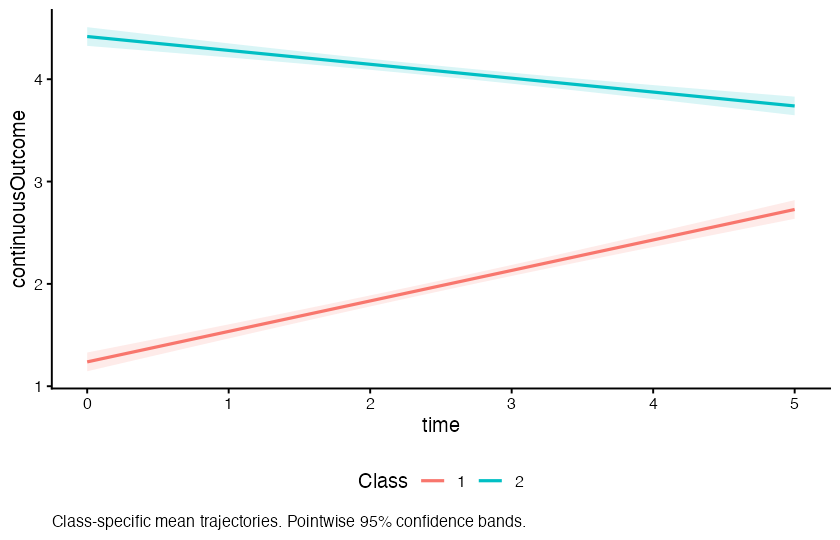

# Trajectories for JASP

An independently maintained, open-source module for **latent class growth
analysis (LCGA)** and **growth mixture models (GMM)** in JASP. Explore continuous
and ordinal longitudinal outcomes, compare class trajectories, and inspect
observed versus fitted patterns using the `lcmm` estimation package.

**Public beta 0.1.0 · Apple Silicon macOS · JASP 0.99.0.0**

**[Download the installer](https://github.com/particle-apps/jaspTrajectories/releases/download/v0.1.0/jaspTrajectories.JASPModule)**
· [Release notes and checksums](https://github.com/particle-apps/jaspTrajectories/releases/tag/v0.1.0)
· [Report an issue](https://github.com/particle-apps/jaspTrajectories/issues)
· [Contribute](CONTRIBUTING.md)

This is an independent community project distributed through GitHub Releases.
JASP Module Library registration and review are separate from this release.
Feedback, reproducible bug reports and contributions are welcome.

## What it does

- Fits LCGA and GMM to continuous or ordered categorical outcomes in long-format data.
- Supports linear, quadratic and cubic mean trajectories, unequal measurement
  times, and random intercepts or intercepts with linear slopes for GMM.
- Reports fit indices, coefficients, class sizes and posterior classification.
- Plots class trajectories with optional pointwise confidence bands.
- Compares observed and fitted trajectories using posterior-probability weights.
- Provides multistart estimation, seed control and explicit convergence checks.



*Example output from automated validation using the included synthetic dataset:
100 subjects measured at six time points.*

## Compatibility

| Component | Supported beta configuration |
| --- | --- |
| Operating system | macOS on Apple Silicon (arm64) |
| JASP | 0.99.0.0 |
| Estimation | lcmm 2.2.2, included in the installer |
| R | JASP's embedded R 4.5.2; no separate R installation required |

Windows, Intel macOS, Linux and other JASP versions remain unverified.
The installer includes its dependencies. Check compatibility before installing.

## Install

1. Download **[jaspTrajectories.JASPModule](https://github.com/particle-apps/jaspTrajectories/releases/download/v0.1.0/jaspTrajectories.JASPModule)**.
2. In JASP, open the **+** module menu and choose **Install Module**. If that option
   is hidden, enable the developer-mode controls in **Preferences → Advanced**.
3. Select the downloaded file and enable **Trajectories**.
4. Open **Trajectories → LCGA and GMM**.

The `.JASPModule` file is the installer. Source archives, build inputs and
validation downloads are available on the [release page](https://github.com/particle-apps/jaspTrajectories/releases/tag/v0.1.0).

## Try an example

Download the [synthetic example CSV](https://raw.githubusercontent.com/particle-apps/jaspTrajectories/v0.1.0/examples/trajectories-long.csv)
and import it into JASP. Each row represents one subject at one measurement time.

| Setting | Continuous example |
| --- | --- |
| Subject ID | `subject` — set the column to **Nominal** |
| Measurement Time | `time` — set the column to **Scale** |
| Outcome | `continuousOutcome` |
| Outcome type | Continuous |
| Model | LCGA |
| Classes | 2 |
| Trajectory | Linear |

For an ordinal example, use `ordinalOutcome`, select **Ordinal (Threshold Model)**,
verify the category order 1–5, and start with one class. Check the **Ordinal
Category Order** table before interpreting results.

Set numeric subject IDs to Nominal explicitly. JASP's automatic conversion can
reject IDs with more than 100 distinct values; this is a column-type constraint.

## Beta scope and validation

The automated suite passed **257 numerical assertions**, including checks of
**14 freshly fitted reference cases**, alongside native JASP output, caching and plot-export checks.
The installer passed isolated native installation and code/resource identity
checks. See [VALIDATION.md](VALIDATION.md) for evidence and known limitations.

**The full desktop walkthrough has not been performed for this installer.**
Interactive import, control changes, and saving/reopening JASP documents remain
unverified for this release. Other platforms are also unverified.

This beta supports one outcome and one specified class count per analysis.
Wide-format input, covariates, weights, imputation and bootstrap class tests are
not supported. Successful convergence does not prove a global optimum or establish
the correct number of classes; examine multiple starts and seeds.

For time scaling, missing-data behaviour, ordinal interpretation, confidence
bands and the prediction correction, read the [model guide](USAGE.md) or
[in-app help](inst/help/trajectories.md).

## Documentation and development

| Resource | Contents |
| --- | --- |
| [Model guide](USAGE.md) | Supported models, output and interpretation |
| [Validation record](VALIDATION.md) | Completed checks, evidence and limitations |
| [Build instructions](BUILDING.md) | Tested environment, pinned inputs and source build |
| [Testing](TESTING.md) | Complete validation command and test scope |
| [Dependency sources](DEPENDENCY-SOURCES.md) | Source archives, licences and provenance |
| [Contributing](CONTRIBUTING.md) | Bug reports, proposals and pull requests |
| [Changelog](NEWS.md) | Release features |

The repository root is the R package root. After following the prerequisites in
[BUILDING.md](BUILDING.md), build and test with:

```sh
sh scripts/build-macos.sh
sh scripts/run-tests.sh
```

The supplied [complete source and validation archive](https://github.com/particle-apps/jaspTrajectories/releases/download/v0.1.0/jaspTrajectories-public-beta-0.1.0-source-validation.zip)
preserves the files used for the published beta. To browse the numerical report,
download the [validation ZIP](https://github.com/particle-apps/jaspTrajectories/releases/download/v0.1.0/jaspTrajectories-validation.zip),
extract it, and open `validation/START-HERE.html` in a browser.

## Support and licence

Maintained by **Daniel Corcoran**. Use [GitHub Issues](https://github.com/particle-apps/jaspTrajectories/issues)
for reproducible bugs and feature requests, or contact
[particleapps@proton.me](mailto:particleapps@proton.me). Include module/JASP
versions, operating system, model settings, the exact error and a small synthetic
or anonymised example. Do not post identifiable participant data.

The module is licensed under **GPL version 2 or later**; see [LICENSE](LICENSE).
Dependencies retain their own licences and notices.

For the estimation methods, cite:

Proust-Lima, C., Philipps, V., & Liquet, B. (2017). Estimation of extended mixed
models using latent classes and latent processes: The R package lcmm.
*Journal of Statistical Software, 78*(2), 1–56.
[doi:10.18637/jss.v078.i02](https://doi.org/10.18637/jss.v078.i02).
